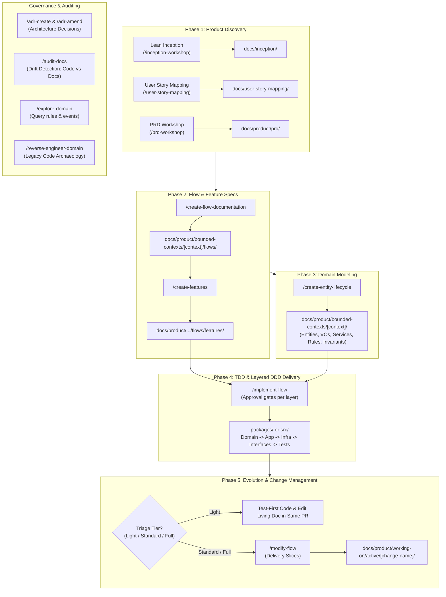

# SDLC Skills for Real Engineering

Universal, spec-driven, DDD & TDD agent skills that govern the entire software development life cycle. Plug-and-play across Claude Code, GitHub Copilot, Codex, Cursor, Gemini CLI, Windsurf, Antigravity, and Pi.

Developing complex software with AI agents is difficult. Without strict boundaries, agents hallucinate architectures, skip edge cases, ignore domain constraints, and write throwaway code. 

**SDLC Skills** provides a rigorous, modular framework covering product discovery, story mapping, flow specifications, domain modeling, layered implementation, and drift auditing.

---

## ⚡ Quick Setup (30 seconds)

<details>
<summary><strong>Claude Code</strong></summary>

```bash
claude plugin install sdlc-skills@faparicior
```
*Or clone and link locally:*
```bash
git clone https://github.com/faparicior/sdlc-skills.git ~/.sdlc-skills
bash ~/.sdlc-skills/scripts/link-skills.sh
```

</details>

<details>
<summary><strong>GitHub Copilot</strong> (VS Code & CLI)</summary>

```bash
copilot plugin marketplace add faparicior/sdlc-skills
copilot plugin install sdlc-skills@faparicior
```

Or add to `~/.copilot/settings.json`:
```json
{
  "extraKnownMarketplaces": {
    "faparicior": { "source": { "source": "github", "repo": "faparicior/sdlc-skills" }, "autoUpdate": true }
  }
}
```

</details>

<details>
<summary><strong>Codex & OpenCode</strong></summary>

```bash
codex plugin marketplace add faparicior/sdlc-skills
codex plugin add sdlc-skills@faparicior
```

</details>

<details>
<summary><strong>Gemini CLI</strong></summary>

```bash
gemini skills install https://github.com/faparicior/sdlc-skills.git --path skills/discovery
gemini skills install https://github.com/faparicior/sdlc-skills.git --path skills/specification
gemini skills install https://github.com/faparicior/sdlc-skills.git --path skills/implementation
gemini skills install https://github.com/faparicior/sdlc-skills.git --path skills/architecture
gemini skills install https://github.com/faparicior/sdlc-skills.git --path skills/auditing
gemini skills install https://github.com/faparicior/sdlc-skills.git --path skills/core
```

</details>

<details>
<summary><strong>Cursor, Windsurf, Antigravity, Devin, or Local Files</strong></summary>

Using the universal skills installer:
```bash
npx skills@latest add faparicior/sdlc-skills -a <agent> # cursor, windsurf, opencode, pi, antigravity
```

Or via direct repository linking:
```bash
git clone https://github.com/faparicior/sdlc-skills.git ~/src/sdlc-skills
bash ~/src/sdlc-skills/scripts/link-skills.sh
```

</details>

---

## 🚀 Getting Started in your Repository

In your agent chat within your project workspace, run:

```bash
/setup-sdlc
```

This interactive wizard will:
1. Detect whether your project is a Monorepo or Single App.
2. Configure your documentation root (`docs/`), bounded contexts location, and ADR directories.
3. Scaffold initial directories and copy the canonical guidelines (`traceability.md`, `business-rules-vs-invariants.md`).

Not sure where to begin? Run:
```bash
/sdlc-guide
```

---

## 🔄 The Complete SDLC Lifecycle



---

## 📦 Skills Catalog

| Command | Category | Purpose |
| :--- | :--- | :--- |
| **`/setup-sdlc`** | Core | Bootstraps project settings, directories, and canonical guidelines. |
| **`/sdlc-guide`** | Core | Interactive wayfinder to help you pick the right skill for your task. |
| **`/inception-workshop`** | Discovery | Facilitates full 8-step Lean Inception workshops (Vision to MVP Canvas). |
| **`/user-story-mapping`** | Discovery | User story mapping, backbone activities, INVEST cards, and release waves. |
| **`/prd-workshop`** | Discovery | Structured Product Requirements Document creation and validation. |
| **`/create-flow-documentation`** | Specification | End-to-end user journeys with Mermaid diagrams and business rule tags. |
| **`/create-features`** | Specification | Vertical feature specifications with error handling and HTTP contracts. |
| **`/create-entity-lifecycle`** | Specification | State machines, entities, value objects, domain services, rules, and invariants. |
| **`/create-module`** | Implementation | Scaffolds clean DDD bounded context packages with layer isolation. |
| **`/implement-flow`** | Implementation | TDD/DDD delivery step-by-step with approval gates at each layer. |
| **`/modify-flow`** | Evolution | Manages changes to existing flows via Slices (Light / Standard / Full). |
| **`/reverse-engineer-domain`** | Evolution | Extracts business rules and invariants from brownfield/legacy code. |
| **`/adr-create`** | Architecture | Records new Architectural Decision Records with AI friction analysis. |
| **`/adr-amend`** | Architecture | Amends existing ADRs non-destructively with reciprocal links. |
| **`/adr-review-alternatives`** | Architecture | Evaluates technology stack currency against modern engineering standards. |
| **`/adr-validate`** | Architecture | Scores ADR quality, consequences, and trade-off rigor. |
| **`/audit-docs`** | Auditing | Health check detecting drift between living documentation and actual code. |
| **`/explore-domain`** | Auditing | Read-only exploration of domain rules, events, and entity lifecycles. |
| **`/agents-maintainer`** | Auditing | Audits and updates agent instructions (`AGENTS.md`) and project conventions. |

---

## 🛠️ Development & Linking

If you are developing or customizing skills locally:

```bash
# Link all skills to ~/.claude/skills and ~/.agents/skills
npm run link

# List all skills and verify their headers
npm run list
```

## 🧭 Portability & Stack-Specific Skills

The pack's conventions are language- and framework-agnostic: traceability, flow structure and the
BR/INV/flow templates use placeholders (`<source-root>`, `<test-root>`, `<docs-root>`) instead of any
stack's real paths, and the skills that write into a repository discover its layout (Step 0) instead
of assuming one. A few skills are deliberately stack- or origin-specific — know what you are
installing:

| Skill | Scope | Notes |
|-------|-------|-------|
| `create-module` | **TypeScript / Turborepo only** | Scaffolds npm-workspace packages with `tsconfig.json` project references and Drizzle examples. Not usable as-is in other stacks. |
| `adr-create`, `adr-review-alternatives`, `adr-validate` | Generic process; **examples reference the TypeScript ecosystem** (Zod, Next.js, Supabase, Drizzle) | Replace the sample technology rows in the ADR templates with your own stack before use — they get copied into real ADRs. |
| `inception-workshop` | Generic workshop method; **assumes the origin repo's automation layout** (`docs/templates/inception/`, `docs/commands/inception/`) | Validators/commands must exist in the target repo or those steps must be dropped. |
| `agents-maintainer` | Generic purpose; **example AGENTS.md sections are npm/TypeScript-flavoured** (`npm run lint`, Zod, ts-archunit) | Treat the examples as patterns to adapt, not literal content. |
| `evals/` fixtures | Reference the origin product's flows | Test data only; never copied into target repositories. |

### Paths & configuration

Skills default to the pack's canonical layout (`docs/product/bounded-contexts/`, `docs/product/working-on/`,
`docs/adr/`). `/setup-sdlc` writes `.sdlc/config.json`, which can override `docsRoot`, `productDocsDir`,
`guidelinesDir`, `adrDir` and `modulesDir`; when that file exists, honour it over the defaults shown in
the skills. Skills that operate on existing documentation (`audit-docs`, `modify-flow`,
`reverse-engineer-domain`) never assume paths — they discover the docs tree fresh on every run.

## 📄 License

MIT © [Fernando Aparicio](https://github.com/faparicior)
