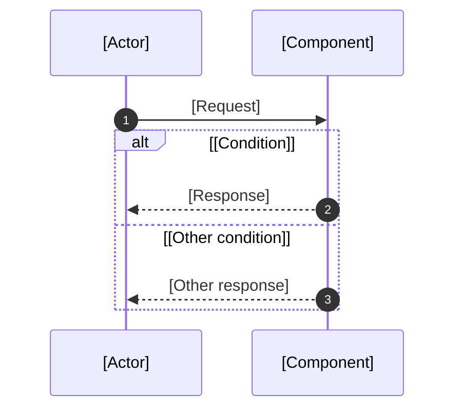

# [Short Title of Solved Problem and Solution]

* **Status:** [Proposed | Accepted | Rejected | Deprecated | Superseded]
* **Date:** [YYYY-MM-DD]
* **Decision Makers:** [Name 1, Name 2]
* **Supersedes:** [ADR-0000](link) | N/A
* **Amended By:** [ADR-0000](link) | N/A

## Summary

| | |
| :--- | :--- |
| **Decision** | [One sentence: what will be done.] |
| **Why** | [The evidence that forces the decision.] |
| **Expected effect** | [The measurable result, with the number.] |
| **Main trade-off** | [The biggest cost accepted.] |
| **Still open** | [Reviews, checks or approvals pending before acceptance.] |

## Context and Problem Statement

[Describe the observed problem and who it affects.]

### Why the Current Setup Falls Short

| Layer or solution | Current behaviour | Why it does not solve the problem |
| :--- | :--- | :--- |
| [e.g., API gateway] | [What it does today] | [The specific gap] |
| [e.g., Another layer] | [What it does today] | [The specific gap] |

### Measurements

[Source, period and date of the data, e.g., Production access logs, 24 hours up to YYYY-MM-DD.] This section needs real figures. If there are none, this is not a problem-driven ADR: use `TEMPLATE-STRUCTURAL.md`.

| Metric | Value |
| :--- | ---: |
| [e.g., Requests] | [Number] |
| [e.g., Share caused by the main actor] | [Number and percentage] |

### Assumptions Confirmed

| Topic | Confirmed by [Name] on [YYYY-MM-DD] |
| :--- | :--- |
| [e.g., Limit and window] | [Value] |
| [e.g., Pending] | [What still needs an owner or a review] |

**Decision Drivers:**
*   [Driver 1, e.g., Force 1]
*   [Driver 2, e.g., Force 2]

## Considered Options

*   [Option 1]
*   [Option 2]
*   [Option 3]

## Decision Outcome

**Chosen Option:** "[Option 1]"

**Justification:**
[Why this option was chosen, tied to the measurements and drivers. e.g., It is the only option that meets the k8s requirement.]

### How It Works

Keep message text free of `<`, `>`, `;` and arrows. Use a `flowchart` instead of a sequence when there is no time order.

### Design

| Component | Behaviour |
| :--- | :--- |
| [e.g., Filter] | [What it does and where it lives] |
| [e.g., Failure handling] | [What happens when it breaks] |
| [e.g., Rollout flag] | [How it is switched on and off] |

### Consequences

*   **Positive:** [e.g., Improved modularity]
*   **Negative:** [e.g., Increased deployment complexity]
*   **Risks:** [See the table below]

| Risk | Impact | Mitigation |
| :--- | :--- | :--- |
| [e.g., Vendor lock-in] | [What happens if it materialises] | [Concrete action or accepted risk] |

### 🤖 AI & Agentic Ergonomics (AX)

* **LLM Corpus Alignment:** [High (>80%) | Medium (30-80%) | Atypical/Exotic (<30%)]

| Expected Agent Bias | Automated Guardrail |
| --- | --- |
| [e.g., Agents write CRUD logic in route handlers] | [e.g., Controller-factory convention + ts-archunit rules over `interfaces/`] |
| [e.g., Agents use primitive types instead of Value Objects] | [e.g., ts-archunit VO rules via `check:arch`] |
| [Bias with no automated countermeasure] | — (accepted manual-review risk — justify or close the gap) |

* **Supervision & Guardrail Tax:** [Low | Medium | High — human review and automated verification overhead]

## Pros and Cons of the Options

### Comparison at a Glance

| Criterion | [Option 1] | [Option 2] | [Option 3] |
| :--- | :--- | :--- | :--- |
| [Criterion tied to a driver] | [Value] | [Value] | [Value] |
| [Criterion tied to a driver] | [Value] | [Value] | [Value] |
| Effort to build | [Low, Medium or High] | [Value] | [Value] |

Every figure in this table must come from the Measurements section or be marked as an estimate.

### [Option 1]

*   Good, because [argument a]
*   Good, because [argument b]
*   Bad, because [argument c]

### [Option 2]

*   Good, because [argument a]
*   Bad, because [argument b]

## Links

*   [Link type] [Link to ADR]
*   [Jira Ticket]
