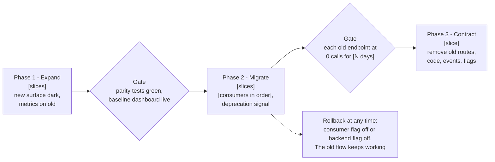
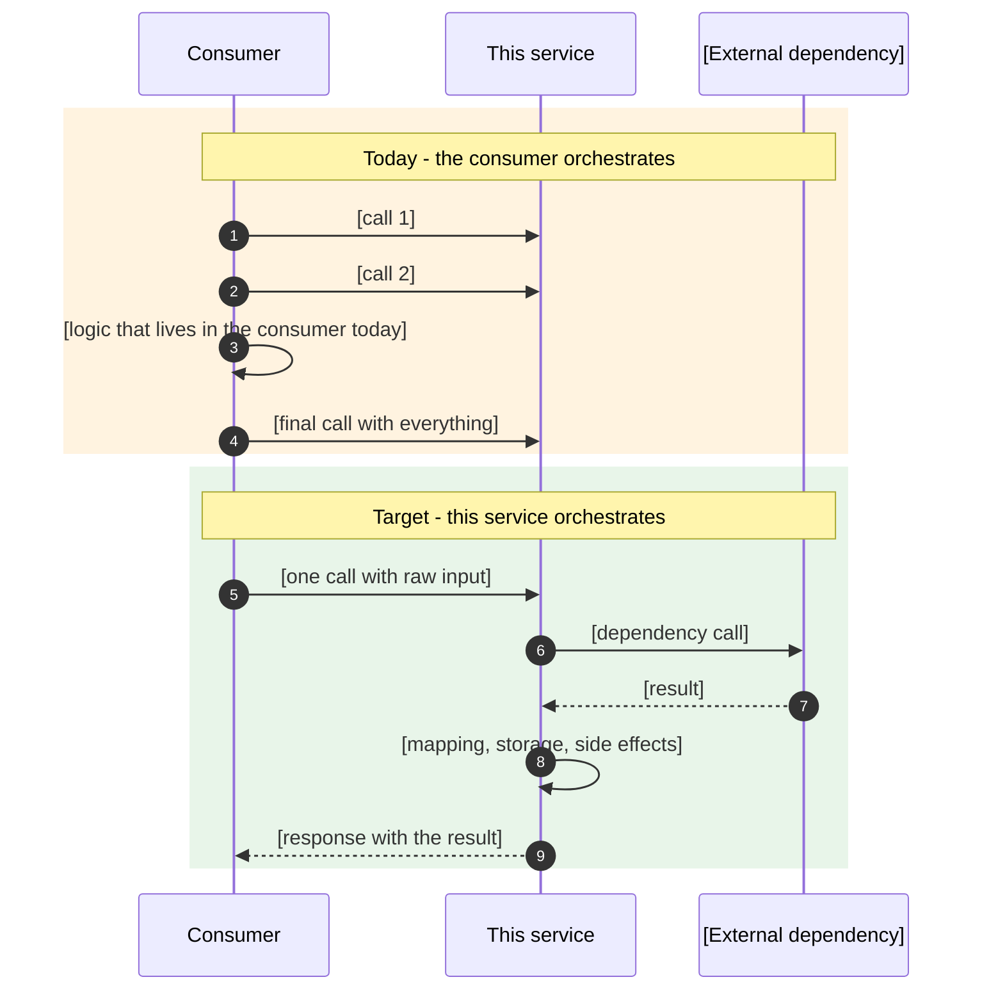
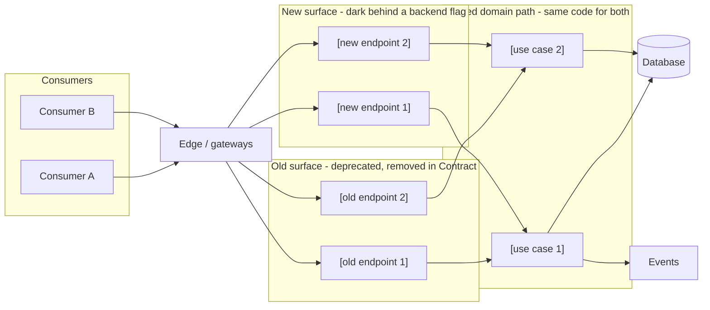

# Implementation Plan: [Change Title] (Parallel Change)

<!--
Use this template INSTEAD of templates/implementation-plan.md when the proposal's Migration & Backward
Compatibility table marks API Contract (or another contract) as "Deprecation" and the old and the new
version must coexist while consumers migrate gradually (staged rollout is an explicit decision in the
proposal). Phases follow the lifecycle Expand -> Migrate -> Contract, NOT inside-out layering.
Everything in [brackets] is a placeholder: replace with this repo's real files, commands and names.
Remove this comment in the delivered document.
-->

* **Status:** 📋 Planned | 🔄 In Progress | ✅ Complete
* **Proposal:** [proposal.md](./proposal.md)
* **Structure:** phases follow the Parallel Change lifecycle; each phase maps to the proposal's slices ([S1-S3] Expand, [S4-S7] Migrate, [S8] Contract)

### Resolved Open Questions

Carry every row of the proposal's Open Questions table with its resolution. Mark what is still open inside the resolution cell, and say which slice it blocks.

| # | Question | Resolution |
| :---: | :--- | :--- |
| 1 | [Question from proposal] | [How it was resolved / **Open:** what remains] |

---

## 0. Cross-Repo Dependencies

Gateways, clients (web, iOS, Android), external providers and schema registries are usually involved in a parallel change. List them all, including repos that are not in the workspace.

| # | Repo / party | Role in this change | Deploy first? |
| :---: | :--- | :--- | :---: |
| 1 | this repo | New surface (disabled), metrics on old and new, deprecation signals, later removal | ✅ |
| 2 | `[gateway repo(s)]` | Routes, stubs and specs for the new surface | After #1 |
| 3 | `[client repo(s)]` | Cutover behind a client-owned flag | After #2 |
| 4 | `[external provider]` | Action: ask them to adopt the new surface | Before Contract |

> **Deploy order note:** [new surface with the backend flag off] → [gateways] → [enable backend flag] → [clients one at a time] → [deprecation signals] → [usage = 0 for the agreed period] → [remove gateway routes] → [remove backend code]. Edges must never route to something that does not exist yet.

---

## 1. Pre-Implementation Checklist

- [ ] Open Questions that block the first slice are closed (list which)
- [ ] Every caller of the old surface is known (this repo, gateways, every client, external parties), by project-wide search plus traffic data
- [ ] Concurrency, idempotency and invariant safeguards from the proposal are covered by tests below, including **the same entity going through the old and the new path**
- [ ] The old and the new path share one domain path (no duplicated business logic)
- [ ] Sunset criterion agreed (e.g. "0 calls for N days across all consumer labels") and minimum supported client versions decided or explicitly out of scope
- [ ] Tickets drafted (see [tickets.md](./tickets.md) if the team tracks work outside this repo's issue tracker)
- [ ] Architecture-decision-record index checked; ADR optional for the orchestration/ownership decision

---

## 2. Phases

Keep this diagram at the top of the section and adjust the slices, consumers and exit criteria:

### Phase 1: Expand — add the new, touch nothing old

**Goal:** the new surface exists, is dark (disabled by a backend flag), reuses the same domain path, and the old surface is instrumented so a traffic baseline exists before any consumer moves.

**1.1 Baseline metrics on the old surface (first PR, no behaviour change)**

- [ ] Find the repo's existing metric pattern and reuse it
- [ ] Counter by endpoint and consumer label (`source`/client/version) for every old endpoint in scope
- [ ] Tests: counted once per call, responses unchanged
- [ ] Dashboard of old traffic by consumer label (the exit signal for Contract)

**1.2 New surface, one task block per slice [S1, S2, ...]**

*Tests first, in this repo's test convention:*

- [ ] Happy path, each business variant, and each early-exit rule of the old path (parity)
- [ ] Failure of every external dependency: nothing stored, nothing published, mapped error code
- [ ] Repeated identical request (replay) and concurrent identical requests: behaviour as decided in the proposal
- [ ] The entity created by the **old** path used through the **new** path and vice versa
- [ ] Events/messages emitted are identical in shape to the old path
- [ ] Backend flag off → the new routes answer 404 (or the agreed disabled behaviour)

*Implementation:*

- [ ] Request DTO and mapper (translation layer if the clients' mapping moves to the backend; keep a mapping inventory document as the spec)
- [ ] Use case that reuses the existing domain path; no business logic copied from the old controller
- [ ] Controller gated by a backend flag; error mapping; usage metric with the same labels as 1.1
- [ ] Create the flag disabled in every environment

**1.3 Gateways / edge**

- [ ] Routes, stubs and specs for each new endpoint in every gateway repo, following the existing pattern there
- [ ] Deploy only after the new surface is in production (flag still off)

**Deliverables:** new surface, tests, metrics on old and new, disabled flag, gateway routes.
**Exit criteria:** parity tests green; with the flag on in a non-production environment a submit through the edge matches the old path's stored data and events; baseline dashboard live.

### Phase 2: Migrate — move consumers one at a time

**Goal:** each consumer switches behind its own flag; the old surface stays as the rollback path.

- [ ] 2.0 Enable the backend flag in production (after the edge is deployed)
- [ ] 2.1 [Consumer A]: implement, gradual rollout, compare error rate, latency and stored data/event counts old vs new; rollback = consumer flag off
- [ ] 2.2 [Consumer B]: same
- [ ] 2.3 [Consumer C]: same
- [ ] 2.4 [External party]: switch confirmed by the provider and by the usage metric
- [ ] 2.5 Deprecate: add the repo's deprecation signal (e.g. `Deprecation`/`Sunset` headers) to the old surface, backward compatible and tested; alert on traffic appearing on an endpoint already at zero
- [ ] 2.6 Review unexplained callers of old endpoints from the dashboard and decide their fate

**Exit criteria (per old endpoint):** [0 calls for N consecutive days] on the usage metric, across all consumer labels.

### Phase 3: Contract — remove the old

**Goal:** only the new surface remains.

- [ ] 3.1 Confirm no other callers of anything about to be deleted
- [ ] 3.2 Remove old edge routes first (unknown traffic fails at the edge), deploy
- [ ] 3.3 Remove old controllers, use cases, producers/consumers, schemas and the flags that only gated them; keep what the new path still reuses
- [ ] 3.4 Remove or rewrite the old acceptance tests so the new ones are the only coverage
- [ ] 3.5 Deprecate retired event schemas following the registry repo's own rules
- [ ] 3.6 Remove the backend flag of the new surface once nothing depends on it
- [ ] 3.7 Run the architecture tests after each removal, then the full unit and integration suites

**Exit criteria:** no references to removed endpoints in this repo or the edge; suites green; docs updated (section 4).

---

## 3. Validation

Use this repo's real commands (from its contributor guide), not defaults of another stack:

- [ ] `[unit test command]`, full suite
- [ ] `[integration test command]`
- [ ] `[architecture check command, if any]`
- [ ] `[formatter/lint command]`
- [ ] Gateway repos: their own test commands
- [ ] Non-production end-to-end: submit through the edge and compare stored data and events with an old-path submit of the same input

---

## 4. Documentation Update (after each slice ships)

Execute the proposal's "Impact on Existing Documentation" table slice by slice; planned text stays in `drafts/` until its slice ships. Legacy docs are removed or archived at Contract.

| Doc | How to update | Slice | Status |
| :--- | :--- | :---: | :---: |
| `[flow doc]` | Hand-edit or paired skill: add the new path, mark old deprecated, remove at Contract | [S1, S7, S8] | 📋 |
| `[rule / invariant docs]` | `Enforced by` rows with the new surface; History entry | [S2] | 📋 |
| `[contributor guide]` | Add newly discovered cross-repo boundaries | [S3] | 📋 |

---

## 5. Rollout Notes

### Flags

| Flag | Owner | Purpose | State plan |
| :--- | :--- | :--- | :--- |
| `[backend flag]` | this repo | Dark launch and kill switch of the new surface | Created off; on in dev during [S1]; on in production before Phase 2; removed at 3.6 |
| `[consumer A cutover flag]` | [team] | Chooses old or new path in the consumer | Gradual %; instant rollback |
| `[existing flags the shared domain path reads]` | this repo | Unchanged behaviour | Unchanged until Contract |

### Per-consumer migration table

| Consumer | Repo | Calls to stop | Rollback | Entry criteria | Exit criteria | Status |
| :--- | :--- | :--- | :--- | :--- | :--- | :---: |
| [Consumer A] | [repo] | [old endpoints] | [consumer flag off] | [edge deployed, backend flag on] | [100% new, 0 old calls for N days] | 📋 |

### How to confirm the rollout worked

| Check | Signal |
| :--- | :--- |
| New path healthy | Usage metric of new endpoints by consumer; error rate; latency (note added external calls) |
| Parity | Stored rows and published events per day consistent with the pre-migration trend; duplicates not increasing |
| Old traffic draining | Old counters by consumer trend to 0; any traffic on an endpoint already at 0 raises the alert |
| Ready to contract | Every old endpoint at 0 for the agreed period and unexplained callers decided |

### Risks to watch

| Risk | Mitigation |
| :--- | :--- |
| [Added latency from moved orchestration] | [Measure before enabling; agree timeouts] |
| [Slow-updating clients keep old endpoints alive] | [Decide force-update policy outside this change; Contract waits for the metric] |
| [Consumers map values differently] | [Resolve in the mapping inventory before the first slice is specified] |

---

## 🔗 Related Documentation

- [Proposal](./proposal.md)
- [Mapping inventory](./mapping-inventory.md) *(if the translation moves to the backend)*
- [Tickets](./tickets.md) *(optional)*
- [Flow NN: Name](../../bounded-contexts/[context]/flows/flow-NN-name.md)

---

## Appendix: Diagram skeletons for the proposal (copy into proposal section 3)

Not part of the delivered plan. A parallel-change **proposal** should replace long explanations with these two diagrams at the start of its Desired Behaviour section (before the Before/After table). Keep names generic here, use this repo's real endpoints and classes in the delivered proposal. In flowchart labels write path parameters without braces (`id`, not `{id}`): braces can break rendering.

### A. Before and after (who orchestrates)

### B. Old and new surfaces coexisting (shared domain path)

