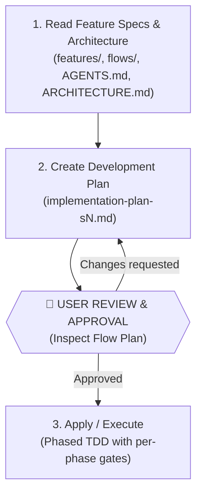
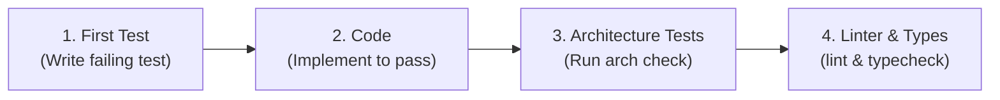

# PROTOCOL: IMPLEMENT-FLOW (EXECUTION LEVEL 3)

<state_machine>
CURRENT_STEP          -> REQUIRED_TOOL                                     -> REQUIRED_OUTPUT                                         -> MANDATORY_HALT
Step 1: Read & Audit  -> read_file / grep (specs, flows, INV-*, AGENTS.md) -> Edge-case & Implementation Trap catalogue + summary     -> Continue to Step 2 (or 🛑 HALT if specs missing)
Step 2: Plan          -> read_file(templates/flow-development-plan.md)     -> working-on/active/[change]/implementation-plan-sN.md    -> 🛑 HALT TURN (Wait for user plan approval)
Step 3: Phased TDD    -> edit_file / run_command (Test->Code->Arch->Lint)  -> Working phase + updated `[x]` in plan                   -> 🛑 HALT TURN per phase (Wait for user confirmation)
</state_machine>

<execution_invariants>
1. WORKFLOW IMMUTABILITY: You may reason freely INSIDE each step to analyze invariants, edge cases, and TDD implementation details, but you are strictly forbidden from skipping steps, bypassing review gates, or reordering phases (`workflow structure = immutable | step reasoning = flexible`).
2. STOP GATES ARE ABSOLUTE (WITH EXPLICIT FAST-TRACK / BATCH OVERRIDE):
   - Gate 1 (Missing Feature Specs): If `docs/product/working-on/active/[change]/features/feature-XX-*.md` does not exist, STOP and invoke `/create-features` first (unless executing a Light-tier 1-file hotfix confirmed by the user).
   - Gate 2 (Plan Approval): You are strictly forbidden from executing Step 3 (writing code) in the same turn as Step 2 (writing `implementation-plan-sN.md`) — unless the user explicitly requested unattended/batch execution in their prompt.
   - Gate 3 (Per-Phase TDD Checkpoints): Execute one phase at a time (`Test -> Code -> Arch Check -> Lint/Typecheck`), update plan checkboxes, and halt for user confirmation before the next phase (unless the user explicitly requested multi-phase batch execution).
3. TEMPLATE LOCK: Reconstructing `flow-development-plan.md` from memory is strictly forbidden. You MUST call `read_file` on `templates/flow-development-plan.md` before writing the plan in Step 2.
4. ESCAPE HATCH: If the situation does not fit the contract, do not silently improvise and do not force-fit: declare the deviation in one line and ask.
</execution_invariants>

<output_contract>
- TARGET_PATH: `docs/product/working-on/active/[change]/implementation-plan-sN.md` (or `implementation-plan.md` for single-slice changes; never in the living tree)
- SOURCE_TEMPLATE: `templates/flow-development-plan.md` (MUST call `read_file` before writing)
- SCHEMA_INVARIANCE: Preserve every H1/H2/H3 heading, `🔗 Cross-Repo Dependencies` table, `🧠 Agent Design Decisions & Assumptions` table, and phased checkbox structure verbatim.
- ESCAPE_HATCH: Never silently omit or invent template sections or phases. If a phase genuinely does not apply to this slice (e.g., `Phase 4: Interfaces / Controllers` for a pure domain event handler), preserve the phase heading and write `"N/A — [1-line rationale]"`, or halt and ask the user before deviating.
</output_contract>

> **Single Source of Truth**:
> - Consult **`AGENTS.md`** (or **`CLAUDE.md`** if absent) and the repo's architecture doc (e.g. **`docs/ARCHITECTURE.md`**) for folder layout, coding style, naming conventions, layer boundaries, and exact verification commands.
> - Consult **`docs/adr/README.md`** for architectural decision records.
> - Paths shown are the pack defaults; if `.sdlc/config.json` exists (written by `/setup-sdlc`), honour its `docsRoot` / `productDocsDir` / `adrDir` overrides.

---

## 🚦 Interactive Control & Review Principle

The user maintains explicit control over every stage and execution step:
1. **Never write implementation code without document approval**: Feature specifications and the flow development plan must be reviewed and approved by the user before code execution begins.
2. **Review gates between stages**: Stop and present documents for user inspection after creating Feature Specs and after creating the Flow Plan.
3. **Phase-by-phase execution control**: Execute code in discrete phases (Phase 0 $\rightarrow$ Phase 5). After each phase, report status, verify architecture/tests, update the plan document, and confirm with the user before proceeding to the next phase.

---

## 🔄 The Implementation Lifecycle

---

### Step 1: Read Feature Specifications, Flow Documentation & Architecture

1. **Verify Prerequisites (Feature Specs Must Exist)**:
   - Check `docs/product/working-on/active/[change]/features/` for the feature specification(s) to implement (e.g. `feature-01-[name].md`).
   - If feature specifications do NOT exist yet, stop and invoke **`/create-features`** first to slice and specify the features before planning implementation.

2. **Inspect Existing Codebase & Artifacts First (Search-First)**:
   - Consult **`AGENTS.md`** (or **`CLAUDE.md`** if `AGENTS.md` is absent) and the repo's architecture doc (e.g. `docs/ARCHITECTURE.md`) to determine the repository's folder structure, bounded context paths, and framework transport layers.
   - **Check for cross-repo dependencies**: Read the `CLAUDE.md` (or `AGENTS.md`) **Cross-Repo Dependencies** section. If this flow touches other repositories, declare them in the plan's `🔗 Cross-Repo Dependencies` table **before writing the plan**. Flag any deploy-order constraint to the user at the summary step.
   - Check if the target bounded context module already exists in the codebase before scaffolding. **Never re-scaffold or overwrite existing modules**.

3. **Read Feature Specification & Domain Rules**:
   - Read the target feature specification: `docs/product/working-on/active/[change]/features/feature-[XX]-[feature-name].md`.
   - Read the parent flow document: `docs/product/bounded-contexts/[context]/flows/[flow-name].md`.
   - Read any associated domain models: `entities/`, `business-rules/`, `invariants/`.
   - Extract the HTTP error contract table, concurrency safeguards, acceptance criteria, and layer scope.

4. **Extract & Catalogue All Edge Cases, Implementation Traps & Cross-Invariants**:
   - Read the feature spec's and flow doc's edge cases, technical failures, and alternative paths.
   - **Cross-check active invariants against new operation sites**: Search `docs/product/bounded-contexts/**/invariants/INV-*.md` (and `docs/product/discovered/invariants/INV-RAW-*.md`) for any invariant whose statement constrains an operation this feature performs (e.g. invoking a domain/application service, creating an aggregate, mutating state, filtering publishers/roles).
   - For each matching INV, ask: *"Does this new code path enforce it?"* — if not explicitly enforced or tested, mark it as **⚠️ Implementation Trap** and add a dedicated test requirement to the catalogue before writing any code. Invariants relevant to an operation may live in a different bounded context or may not yet be listed in the target flow's "Enforced Invariants" section.
   - Produce a numbered catalogue of **every** edge case, technical failure mode, cross-invariant boundary, and validation trap.
   - For each item, explicitly ask: *"Would a naive implementation contradict this?"* — mark those as **⚠️ Implementation Trap** (e.g. a guard that skips an exclusion list when the spec requires exclusion).
   - This catalogue is the primary input for Phase 0 test writing. Every item must map to at least one test before implementation begins.

5. **Consult Architectural Documents & ADRs (Single Sources of Truth)**:
   - **`AGENTS.md`** and the repo's architecture doc (e.g. `docs/ARCHITECTURE.md`): For directory layout, package boundaries, framework routes/entrypoints, and verification commands.
   - The repo's architecture-rules/conventions doc, if present (e.g. `docs/ARCHITECTURE-RULES.md`): For strict DDD templates (Value Objects, Entities, Domain Events, Exceptions, CQRS Handlers, Response DTOs, and Repositories).
   - **`docs/adr/README.md`**: For architectural decisions relevant to this flow (CQRS, Auth, Storage, Data Access, Outbox, API Contracts).

6. **Summarize Understanding & Scope**:
   - Present a clear summary of the current codebase state (existing vs missing files), target feature scope, and impacted layers to the user before generating the implementation plan.

---

### Step 2: Create Flow Development Plan (`OUTPUT CONTRACT`)

1. **MANDATORY TOOL CALL:** Call `read_file` on `templates/flow-development-plan.md` (located in this skill's `templates/` directory) before writing the plan.
2. Save the plan in the change folder as `docs/product/working-on/active/[change]/implementation-plan-sN.md`, one slice at a time and only when slice N starts; record "Grounded against commit X" in it. A single-slice change uses `implementation-plan.md`. Never put it alongside the flow doc in the living tree.
3. **Preserve Template Schema:** Keep every section heading, metadata line, and table structure from `templates/flow-development-plan.md` verbatim.
4. **Populate the Lack of Information Log**:
   - Consolidate all architectural decisions, runtime configurations, and tie-breakers in the `🧠 Agent Design Decisions & Assumptions` table.
5. The plan acts as the **state tracker** containing phased checkboxes (`[ ]` $\rightarrow$ `[x]`) for sequential execution.
6. **🛑 Review Gate (HARD GATE 2 — STOP TURN)**:
   - Stop and present the generated flow development plan to the user with file links.
   - Confirm phase ordering, test scope, affected files, and LLM design decisions.
   - **Do NOT start implementing code (Step 3) until the user explicitly approves the plan.**

---

### Step 3: Apply & Execute (Phase-by-Phase TDD with User Control)

Execute one phase at a time according to `implementation-plan-sN.md`. Within each phase, strictly follow the 4-step micro-cycle:

#### Execution Protocol:
1. **First: Write Test**
   - **Phase 0 only — spec-driven test enumeration before writing any code**:
     1. Open the edge case catalogue built in Step 1.
     2. Write one failing acceptance test per catalogue item — happy path AND every documented edge case, technical failure, and implementation trap.
     3. Tests must be derived from the spec, not from what the implementation will look like. If the spec says "delivery continues when X is null", the test must assert delivery happened — even if the naive implementation would skip it.
     4. Only proceed to implementation once the full catalogue has test coverage.
   - **Phases 1–4 — spec cross-check before each test**:
     Before writing each unit or integration test, verify it against the flow spec's acceptance criteria and edge case catalogue. If a test would pass with a naive implementation that contradicts a documented edge case, **the spec wins** — fix the test to match the spec, not the other way around.
   - Run the test $\rightarrow$ must **FAIL** initially (verifying test validity).
2. **After: Implement Code**
   - Implement only the code necessary to make the test **PASS**.
3. **After: Run Architecture Tests & Checks**
   - Run the architecture checks defined in `AGENTS.md` (e.g. `npm run check:arch`).
   - Ensure layer boundaries and invariants remain unviolated.
4. **After: Run Linter & Typecheck**
   - Run project linter and typecheck commands defined in `AGENTS.md` (e.g. `npm run lint:fix && npm run typecheck`).
5. **Update State & Checkpoint**:
   - Mark completed checkboxes (`- [x]`) in `implementation-plan-sN.md`.
   - **🛑 Phase Checkpoint**: Report the phase completion and verification results to the user.
   - Ask for user confirmation before beginning the next phase.

---

## 📝 Planning Templates

- **Flow Plan Template**: `templates/flow-development-plan.md`
- **Feature Spec Template**: `templates/feature-specification.md`

---

## ✅ Definition of Done
A flow/feature is considered complete when:
1. All checkboxes in `implementation-plan-sN.md` are marked `[x]`.
2. All Definition of Done criteria listed in `AGENTS.md` pass (Architecture tests, Unit/Integration tests, E2E tests, Linting, and Typechecking).
3. For a `/modify-flow` proposal: the slice's `drafts/` are copied into their living docs (links fixed, re-checked against the code, traceability filled in) and deleted, and the slice is marked `Shipped` in the proposal. Every domain-service doc touched by the feature is updated: Part A1–A3 and Part B rows describe the shipped behaviour (Methods status, Traceability with real file/guard/test title), and the feature's row is removed from Part A4 (Pending Changes).
4. Final verification results have been presented to and approved by the user.

---

<self_validation_gate>
Before ending your turn, verify every applicable item below with concrete evidence (not just a checkmark). If any item for your current stage cannot be cited with real evidence from this turn, DO NOT end your turn — return to the failed step and fix the violation first:
- [ ] **Prerequisite & Step 1 Evidence:** Exact feature spec path (`working-on/active/[change]/features/feature-XX-*.md`), flow doc, and `INV-*` files read via `read_file`: `<paths>`
- [ ] **Template Read Evidence (Step 2):** Exact path passed to `read_file` (`templates/flow-development-plan.md`): `<path>`
- [ ] **Plan Output & Schema Evidence (Step 2):** Exact plan path written (`working-on/active/[change]/implementation-plan*.md`) with all sections/phases preserved (noting any `"N/A — [rationale]"` phase): `<path>`
- [ ] **Halt Gate 2 Evidence:** Confirm 0 production/test code files modified in the Plan turn (or cite explicit user batch override): `<0 code edits or batch override>`
- [ ] **Phased TDD Evidence (Step 3):** Exact test file written first, implementation file edited, and verification commands (`test`, `arch`, `lint`, `typecheck`) executed with exit code `0`: `<files & commands>`
</self_validation_gate>