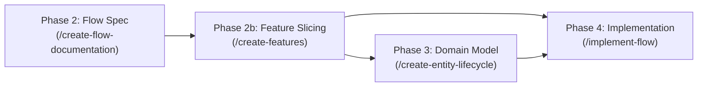

# PROTOCOL: CREATE-FEATURES (EXECUTION LEVEL 3)

<state_machine>
CURRENT_STEP          -> REQUIRED_TOOL                                 -> REQUIRED_OUTPUT                                         -> MANDATORY_HALT
Step 1: Read Flow     -> read_file (flow, AGENTS.md, ADRs)             -> Vertical slice boundaries (F1, F2...)                   -> Continue to Step 2
Step 2: Edge/INV      -> grep / read_file (all bounded-contexts/INV-*) -> Concurrency, TOCTOU & cross-context invariant catalogue -> Continue to Step 3
Step 3: Contracts     -> define requirements & HTTP error mapping      -> F[X]-R[Y] checklist + HTTP Error Contract table         -> Continue to Step 4
Step 4: Write Specs   -> read_file(templates/feature-specification.md) -> working-on/active/[change]/features/feature-NN-*.md     -> Continue to Step 5
Step 5: Review Gate   -> present summary & Lack of Information Log     -> User review prompt                                      -> 🛑 HALT TURN (Wait for user)
</state_machine>

<execution_invariants>
1. WORKFLOW IMMUTABILITY: You may reason freely INSIDE each step to analyze flows, concurrency, and cross-context invariants, but you are strictly forbidden from skipping, reordering, or merging steps (`workflow structure = immutable | step reasoning = flexible`).
2. STOP GATES ARE ABSOLUTE (WITH EXPLICIT BATCH OVERRIDE): After generating feature specification file(s) in Step 4/5, you MUST halt your turn immediately and wait for user approval before invoking `/create-entity-lifecycle` or `/implement-flow` — unless the user explicitly requested unattended batch execution in their prompt.
3. TEMPLATE LOCK: Reconstructing template headers or tables from internal memory is strictly forbidden. You MUST call `read_file` on `templates/feature-specification.md` before writing any feature specification file.
4. STRICT OUTPUT LOCATION: Save feature specifications exclusively under `docs/product/working-on/active/[change]/features/feature-NN-[name].md` (or `.sdlc/config.json` override), NEVER in the living `bounded-contexts/` tree.
</execution_invariants>

<output_contract>
- TARGET_PATH: `docs/product/working-on/active/[change]/features/feature-NN-[name].md`
- SOURCE_TEMPLATE: `templates/feature-specification.md` (MUST call `read_file` before writing)
- SCHEMA_INVARIANCE: Preserve every H1/H2/H3 section heading, metadata field, requirement ID format (`F[X]-R[Y]`), HTTP Error Contract table, Concurrency/TOCTOU table, Layer Scope, and `🧠 Agent Design Decisions & Assumptions` table verbatim.
- ESCAPE_HATCH: Never silently omit or invent template sections. If a section genuinely does not apply to a slice (e.g., `HTTP Error Contract` for an internal cron/queue worker), preserve the heading and write `"N/A — [1-line rationale]"`, or halt and ask the user before deviating.
</output_contract>

> **Paths**: the locations shown are the pack defaults; if `.sdlc/config.json` exists (written by `/setup-sdlc`), honour its `docsRoot` / `productDocsDir` / `adrDir` overrides.

---

## 🔄 Position in the SDLC Workflow



* **Inputs**: `docs/product/bounded-contexts/[context]/flows/[flow-name].md` + Architectural references (`AGENTS.md`/`CLAUDE.md`, the repo's architecture doc e.g. `docs/ARCHITECTURE.md`, `docs/adr/`).
* **Outputs**: `docs/product/working-on/active/[change]/features/feature-[01]-[feature-name].md`, `feature-[02]-[feature-name].md`...
* **Next Steps**:
  * If domain entities/rules need modeling: Invoke **`/create-entity-lifecycle`** (Phase 3).
  * If domain models already exist: Invoke **`/implement-flow`** (Phase 4) with the target feature.

---

## 📋 Step-by-Step Execution Workflow

### Step 1: Read Flow Documentation, ADRs & Architecture

1. **Read the Target Flow Specification**:
   - Locate and read `docs/product/bounded-contexts/[context]/flows/[flow-name].md`.
   - Analyze the complete interaction sequence: sequence diagrams, flowchart decision branches, entity state transitions, and step-by-step walkthrough.
   - Extract the user value, primary actor, and boundaries.

2. **Inspect Existing Features & Bounded Context Layout**:
   - Check `docs/product/working-on/active/[change]/features/` for existing specs and determine the next sequential number (`01`, `02`, `03`...). Don't look in the living tree.
   - Check `AGENTS.md` (or `CLAUDE.md`) and the repo's architecture doc (e.g. `docs/ARCHITECTURE.md`) for directory layout, DDD package boundaries, and verification commands.
   - Review relevant ADRs in `docs/adr/README.md` (e.g., CQRS, Transactional Outbox, Auth, Error Mapping).

3. **Identify Vertical Slices (Feature Boundaries)**:
   - A single flow journey often contains multiple distinct user capabilities or sequential phases (e.g. Journey 01 contains: (1) Event & CfP creation form submission, and (2) Dashboard redirection & CfP link copying).
   - Slice the journey into cohesive, independently verifiable vertical features.
   - Assign sequential IDs: `F1` (`feature-01-[name].md`), `F2` (`feature-02-[name].md`), etc.

---

### Step 2: Extract Edge Cases, Concurrency & Invariant Integrity Analysis

For each feature slice, conduct a thorough technical analysis:

1. **Extract & Catalogue All Edge Cases and Implementation Traps**:
   - Read the flow doc's "Edge Cases & Invariant Integrity", "Technical Failures", and "Alternative Paths".
   - Catalogue each item and flag potential **⚠️ Implementation Traps** (e.g. naive validation that breaks business rules, race conditions on duplicate slugs).

2. **Evaluate Concurrency, TOCTOU & Invariant Integrity**:
   - Analyze potential race conditions and check-then-act vulnerabilities:
     * **Uniqueness (TOCTOU)**: Concurrent inserts with duplicate slug/keys $\rightarrow$ `UNIQUE INDEX` + Domain Exception + `409 Conflict`.
     * **Quotas & Limits**: Concurrent actions exceeding free tier limits $\rightarrow$ atomic count check / transaction isolation.
     * **State Machine Race**: Concurrent mutations on the same aggregate $\rightarrow$ optimistic locking / conditional update.
     * **Dual-Write Consistency**: State saved but event dispatch dropped $\rightarrow$ Transactional Outbox in single DB transaction.
     * **Idempotency & Replays**: Repeated requests or duplicate webhooks $\rightarrow$ idempotency key / graceful no-op.

3. **Cross-Check Active Invariants Across Bounded Contexts (Combat Flow Tunnel Vision)**:
   - **Crucial Rule**: Do NOT rely solely on the target flow document's "Enforced Invariants" section, which may omit cross-context rules or lag behind the codebase.
   - Search the entire invariants tree across all bounded contexts:
     * `docs/product/bounded-contexts/**/invariants/INV-*.md`
     * `docs/product/discovered/invariants/INV-RAW-*.md`
   - Identify every invariant whose statement constrains any operation this feature performs (e.g. calling a domain service, mutating aggregate status, calculating dates, filtering roles/publishers).
   - For each matching INV, ask: *"Does this new code path enforce it?"*
     * If not: mark it as **⚠️ Implementation Trap**, add an explicit requirement (`F[X]-R[Y]`), and mandate a dedicated test before coding begins.
     * Tabulate every checked invariant in the feature specification's `🛡️ Concurrency, TOCTOU & Invariant Integrity Analysis` table.

---

### Step 3: Define the Executable Contract & HTTP Error Contract

1. **Define Functional & Non-Functional Requirements**:
   - Use checklist items with explicit IDs: `F[X]-R1`, `F[X]-R2`, etc.
   - Map requirements to existing or planned acceptance tests (e.g., an E2E spec or integration tests).

2. **Construct HTTP Error Contract Table**:
   - Map every potential failure condition to:
     * Condition
     * Domain Exception class
     * Domain Error Code
     * HTTP Status code
     * User-visible message

   ```markdown
   | Condition | Domain Exception | Error Code | HTTP | User-visible message |
   |-----------|------------------|------------|------|----------------------|
   | CfP end date <= start date | `CfpDatesInvalidError` | `CFP_DATES_INVALID` | 400 | `End date must be after start date` |
   | Duplicate slug | `SlugExistsError` | `SLUG_EXISTS` | 409 | `Conference slug already exists` |
   ```

---

### Step 4: Generate Feature Specification File(s)

1. **File Location**:
   - Always save under `docs/product/working-on/active/[change]/features/feature-NN-[name].md`, never in the living tree. This holds for modifications and for brand-new flows. If no change folder exists, create it with its `proposal.md` first.
   - For multi-slice proposals, write detailed specs **only for the slice about to start**; later slices stay outlines in the proposal's Delivery Slices table and are specified when resumed (features may change or become obsolete before they ship).
   - Lifecycle: the change folder moves to `working-on/grace-period/` and is purged later (`/modify-flow` Step 6). Living docs get the shipped behaviour in the same PR as the code and must not link to feature specs.

2. **Template Compliance (`OUTPUT CONTRACT`)**:
   - **MANDATORY TOOL CALL:** Read `templates/feature-specification.md` via `read_file` before writing.
   - Preserve every section heading and table column from `templates/feature-specification.md` in exact order. Do not omit or rename sections.

3. **Populate the Lack of Information Log**:
   - Document any judgment calls, assumptions, fallback status codes, or tie-breakers made by the LLM in the `🧠 Agent Design Decisions & Assumptions` section:

   ```markdown
   | # | Topic / Area | Documentation State / Gap | Decision / Judgment Made | Status |
   |---|--------------|---------------------------|--------------------------|--------|
   | D1 | Slug collision policy | Conflict between auto-suffix in BR and 409 in E2E | Hard-fail with `SlugExistsError` (409) | 📋 Proposed |
   ```

4. **Define Layer Scope**:
   - Outline impact across Contracts, Domain, Application, Infrastructure, and Interface layers per DDD guidelines.
   - If the feature changes the behaviour of a domain service, name its doc under `docs/product/bounded-contexts/{ctx}/domain-services/` in the layer scope, so the implementation plan and the post-implementation doc update include it.

---

### Step 5: 🛑 Review Gate (User Review & Approval)

* Stop and present the generated feature specification document(s) to the user with clickable file links.
* Summarize:
  1. Number of feature slices created and their scopes.
  2. Key requirements and HTTP error contracts.
  3. All entries in the Lack of Information Log (`D1`, `D2`...).
* **Do NOT proceed to implementation or downstream domain modeling until the user reviews and approves the feature specification.**

---

<self_validation_gate>
Before ending your turn, verify every item below with concrete evidence (not just a checkmark). If any item cannot be cited with real evidence from this turn, DO NOT produce your final response — return to the failed step and fix the violation first:
- [ ] **Step 1 & 2 Grounding Evidence:** List the flow doc, `AGENTS.md`, ADRs, and cross-context `INV-*` files read via `read_file`: `<paths>`
- [ ] **Template Read Evidence:** Exact path passed to `read_file` (`templates/feature-specification.md`): `<path>`
- [ ] **Output & Schema Evidence:** Exact `docs/product/working-on/active/[change]/features/feature-NN-[name].md` path(s) written, number of `F[X]-R[Y]` requirements defined, and any `"N/A — [rationale]"` section noted: `<paths, N requirements>`
- [ ] **Halt Gate Evidence:** Confirm turn stops at Step 5 for user review with 0 production code edits (or cite explicit user batch override): `<0 code edits>`
</self_validation_gate>
